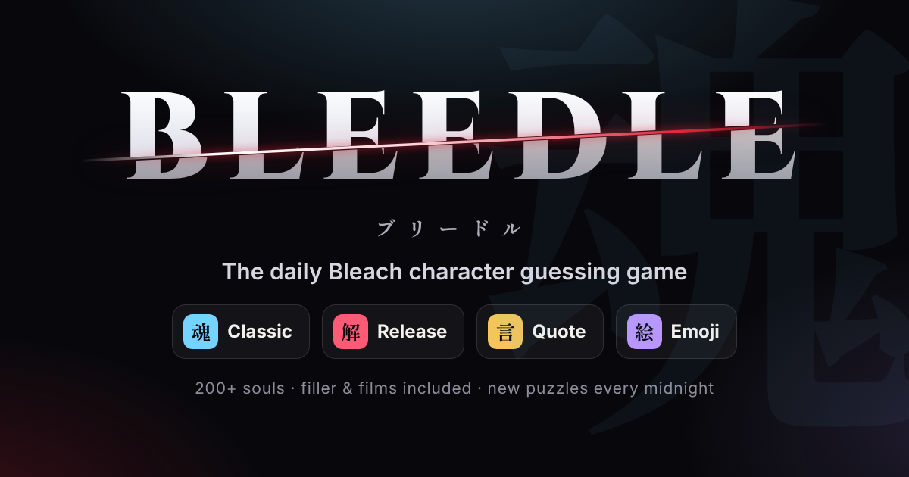

<p align="center">
  
</p>

# Bleedle

**[▶ Play at krishgup.github.io/bleeders](https://krishgup.github.io/bleeders/)**

**The daily Bleach character guessing game.** One Wordle-style main puzzle a day, three quick bonus modes, and
over 200 souls from the manga, every filler arc, and the films.

**魂 Classic is the main event:** deduce the character from seven attributes: gender, race, affiliation, rank,
insignia, hair and debut arc. Tiles turn green, yellow or red, and arrows point toward the answer.

**Bonus modes** for when one soul a day isn't enough:

- **解 Release:** name the wielder of a release command, Bankai, Resurrección, Quincy Schrift, Fullbring or Bount
  doll. Each miss unlocks another clue.
- **言 Quote:** guess who said a memorable line.
- **絵 Emoji:** five emoji describe a character. One is shown at the start, and each miss reveals another.

New puzzles arrive at local midnight and are the same for everyone. Guesses are unlimited.

## Features

- **217 characters.** Canon, plus every anime-only arc (Bount, Amagai, Zanpakutō Unknown Tales, Gotei 13 Invading
  Army), Hueco Mundo filler episodes, and the four films. Filler characters can be daily answers too.
- **Endless training.** Unlimited puzzles in every mode, filtered by _Everyone_, _Main cast_, _Canon_ or
  _Filler & films_.
- **Archive.** Replay any past daily puzzle in any mode. Replays have their own stats, never touch your streak, and
  shared results link straight to the same puzzle.
- **Soul Registry.** Browse and filter every character's dossier, and collect each one by solving it. Solving a soul
  also unlocks its release, quote and emoji clues in the registry.
- **23 achievements,** from _Shunpo_ (win on your first guess) to _Bankai_ (clear all four modes in a day) to
  _Soul King_.
- **Stats.** Streaks, win rate, average guesses and a guess-distribution chart for each mode, kept separately for
  daily, endless and archive play.
- **Sharing.** Spoiler-free emoji grids with streak and hint counts. Uses the native share sheet on phones and the
  clipboard elsewhere.
- **Hints and look-alikes.** Classic offers optional hints: an epithet after 5 misses and a redacted dossier after 9.
  When two characters share every attribute, the "twin soul" banner lists them.
- **Polish.** Generated soul crests (original artwork with no copyrighted images), flip animations, reiatsu particle
  effects, synthesised sound effects, and dark and light themes.
- **Made for phones.** Dialogs become bottom sheets you can swipe away, the guess box lifts above the on-screen
  keyboard (and drops back after each guess), a menu sheet puts every mode one tap away, and layouts respect notches
  and the home indicator. Checked from 320px phones up to tablets, in portrait and landscape.
- **Accessibility.** Colour-blind palette, reduced-motion mode, full keyboard support, an ARIA combobox, and native
  `<dialog>` modals.
- **Offline-capable PWA.** Installable, with a service worker that caches the app shell. Progress is stored locally,
  with export and import of save files.

## How the daily answer is chosen

Each mode uses **weighted rendezvous hashing** ([`src/lib/daily.ts`](src/lib/daily.ts)):

1. For each day, every eligible character gets the score `weight / -ln(hash(mode, day, id))`, and the highest score
   wins. Weight depends on prominence (tier 1: ×3 … tier 4: ×1), so the main cast appears more often but deep cuts
   still show up.
2. A character can't repeat within a cool-down window (150 days in Classic, 90 in the other modes).
3. Launch week is hand-picked ([`PINNED` in `src/game/engine.ts`](src/game/engine.ts)).

Rendezvous hashing has a useful property: **adding a character only changes the days that character wins.** Every
other past and future puzzle keeps its answer. Once a player starts a daily, its answer is also saved with their
game, so it never changes under them.

## Development

Requires Node 20.19+ (22 recommended).

```bash
npm install
npm run dev          # http://localhost:5173
npm run check        # typecheck + lint + tests
npm run build        # production build in dist/
npm run preview      # serve the production build
```

| Script                    | What it does                                                                |
| ------------------------- | --------------------------------------------------------------------------- |
| `npm test`                | Vitest: game logic, schedule, search, state, share text, data checks        |
| `npm run lint` / `format` | ESLint (flat config, React Hooks rules) and Prettier                        |
| `npm run icons`           | Re-renders PNG icons and the Open Graph card with headless Chromium         |
| `npm run fonts`           | Re-subsets the Japanese display font (needs `pip install fonttools brotli`) |

### Project layout

```
src/
  data/          character roster (by faction), release/quote/emoji clues, taxonomy
  game/          engine (schedules, clue ladders), achievements, share text
  lib/           pure helpers: hashing, dates, compare, search, storage, sound
  state/         persisted game state + reducers, UI store
  components/    UI building blocks (board, clue cards, combobox, modals…)
  pages/         Home, Mode, Soul Registry, Achievements
  styles/        design tokens + CSS
  test/          Vitest suites
```

## Adding or editing characters

Characters live in [`src/data/characters/`](src/data/characters), one file per faction. Each entry needs every
Classic attribute:

```ts
{
  id: 'kisuke-urahara',            // stable kebab-case id — never rename (saves reference it)
  name: 'Kisuke Urahara',
  jp: '浦原 喜助',
  aliases: ['Urahara', 'Hat-and-Clogs'],
  gender: 'Male',
  race: ['Shinigami'],             // hybrids list several, e.g. Visored = Shinigami + Hollow + Visored
  affiliation: ['Urahara Shop'],
  rank: 'Former Captain',          // latest rank in the main story (before the epilogue)
  division: 12,                    // Gotei division; 0 = Royal Guard; null = none
  hair: ['Blonde'],
  debut: 'substitute',             // arc id from src/data/taxonomy.ts
  origin: 'canon',                 // 'canon' | 'filler' | 'movie'
  tier: 1,                         // 1 = iconic … 4 = deep cut (controls daily frequency)
  epithet: 'Former Captain of the 12th Division',
  bio: 'One sentence that never names the character.',
}
```

Optional fields: `espada` (the Espada's own number, or their master's for Fracción) and `schrift` (Sternritter
letter). The Insignia column uses these.

Release, quote and emoji clues live in [`releases.ts`](src/data/releases.ts), [`quotes.ts`](src/data/quotes.ts) and
[`emoji.ts`](src/data/emoji.ts). `npm test` checks the data for duplicate ids, invalid values, bios or quote
contexts that name the character, emoji sets that aren't exactly five, fully identical look-alikes, and more. If you
add Japanese text, run `npm run fonts`.

## Deployment

The site is fully static and uses hash routing and relative asset paths, so it works on any host and in any
sub-path.

**GitHub Pages:** [`deploy.yml`](.github/workflows/deploy.yml) builds and publishes on every push to `master`. Turn it
on once under **Settings → Pages → Build and deployment → Source: GitHub Actions**. The site will be at
`https://<owner>.github.io/<repo>/`.

**Elsewhere** (Netlify, Vercel, Cloudflare Pages…): build with `npm run build` and publish `dist/`. Set
`VITE_SITE_URL` to the public URL so Open Graph previews use absolute links.

## Credits

Bleedle is a free, unofficial fan project. _Bleach_ and all of its characters are © Tite Kubo / Shueisha, TV Tokyo,
dentsu and Pierrot. This project is not affiliated with or endorsed by them. Character crests, icons and all other
artwork are original. Character facts were cross-checked against community references such as the Bleach Wiki.
